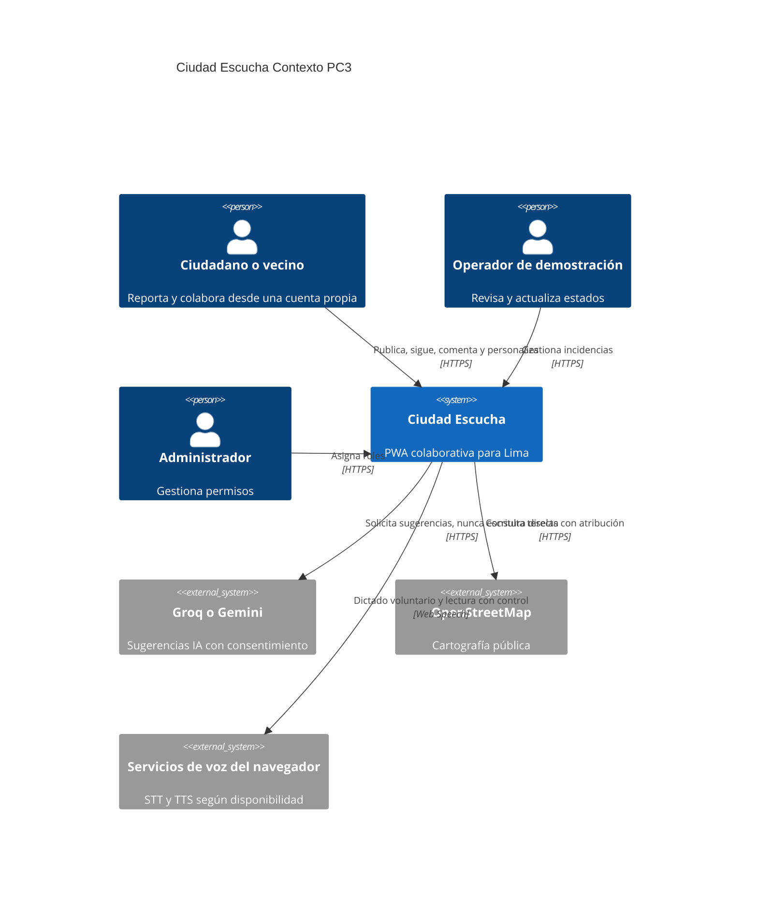
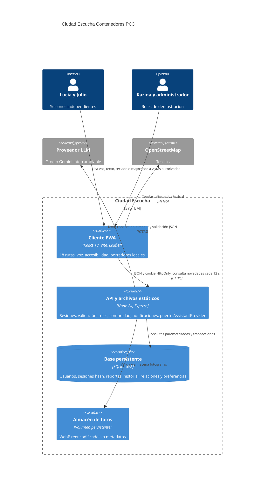

# Arquitectura C4 actual

## Nivel 1 Contexto

## Nivel 2 Contenedores

En despliegue, API, archivos estáticos y adaptador LLM son módulos de un mismo proceso. La PWA vive en el navegador, SQLite y fotos en un volumen. La separación del diagrama es lógica; no implica microservicios. Las preferencias son tablas del mismo servidor, a diferencia de la propuesta conceptual PC2.

## Flujo multiusuario

Lucía confirma una publicación. La API valida sesión y campos, inserta reporte, evento inicial y seguimiento en una transacción. Julio obtiene el registro mediante su propia cookie, apoya con clave única `(usuario, reporte)` y comenta. Se crean notificaciones para autor/seguidores. Karina cambia el estado con autorización explícita; se guarda actor, nota y fecha, y se notifica. El polling recupera cambios; recargar consulta la misma BD. No hay estado compartido basado en localStorage.

## Frontera de confianza de IA

`AssistantProvider.suggest` devuelve únicamente texto/campos sugeridos. El contexto incluye hasta cinco reportes propios y seis turnos si hay consentimiento para guardar. La salida se valida con Zod. `POST /assistant/drafts` prepara un borrador autenticado; `POST /assistant/drafts/:id/confirm` valida autor y confirmación, con clave idempotente. Las consultas de estado y memoria en lenguaje acotado usan datos de API y se etiquetan como guía local. No se ejecutan instrucciones del modelo ni HTML procedente del usuario. Quedan P1 herramientas libres por voz para apoyar/seguir y STT remoto propio.

